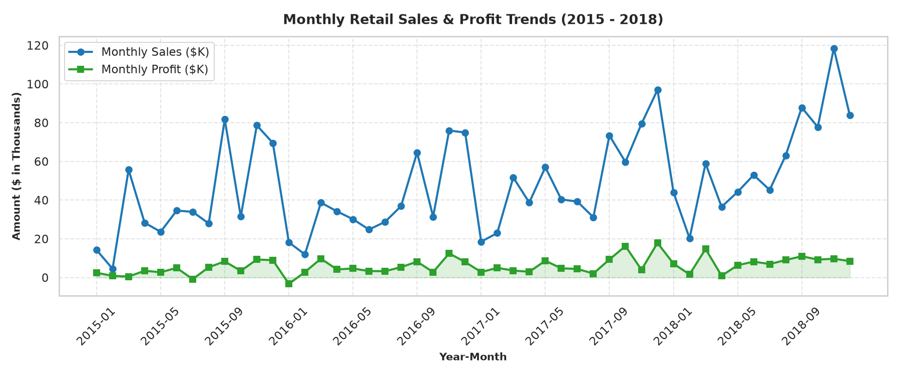
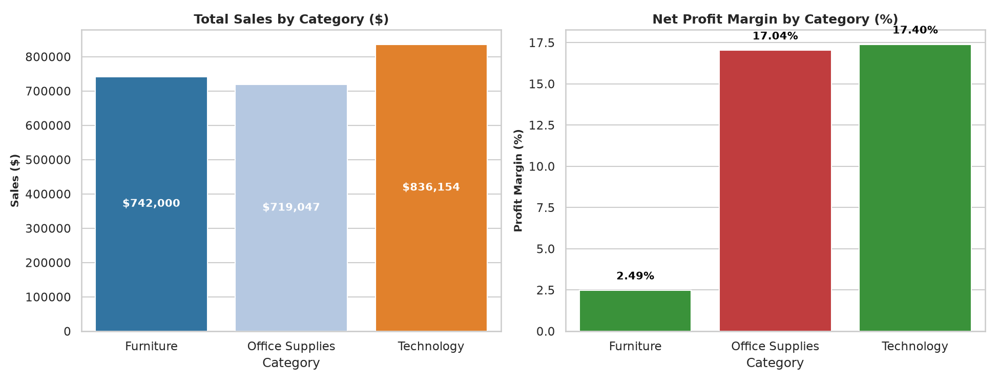
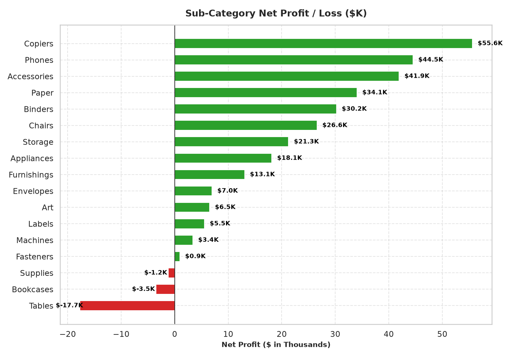
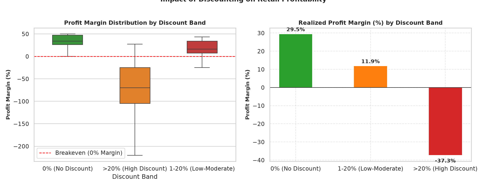
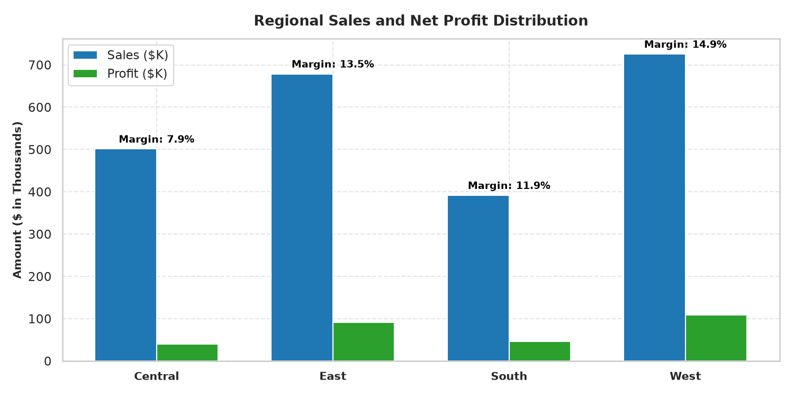

# Retail Sales Analysis & Business Performance
### An Exploratory Data Science & SQL Analytics Portfolio Project

[](https://www.python.org/)
[](https://jupyter.org/)
[](https://pandas.pydata.org/)
[](https://www.sqlite.org/)
[](LICENSE)

An exploratory data science and SQL analytics project analyzing 4 years of retail transaction history from the **Tableau Sample Superstore** dataset. The project evaluates sales volume, product catalog profitability, regional distribution, seasonal cycles, and the financial impact of discounting on business margins.

Designed as an understandable, notebook-first portfolio project suitable for data science internships, placement interviews, and LinkedIn showcases.

---

## 1. Project Structure

The project follows a clean, notebook-first structure:

```
Retail-Sales-Analysis/
│
├── data/
│   └── retail_sales.csv            # Real retail dataset (Tableau Sample Superstore)
│
├── notebooks/
│   └── retail_sales_analysis.ipynb # Primary deliverable: Full analysis, code, and outputs
│
├── sql/
│   └── sales_analysis.sql          # 10 core analytical SQL business queries
│
├── outputs/
│   └── charts/                     # Final publication-grade charts saved by the notebook
│       ├── 01_monthly_sales_trend.png
│       ├── 02_sales_profit_by_category.png
│       ├── 03_sub_category_profitability.png
│       ├── 04_discount_vs_profit_margin.png
│       └── 05_regional_performance.png
│
├── README.md                       # Complete project guide and findings summary
└── requirements.txt                # Minimal Python package dependencies
```

---

## 2. Dataset Overview

- **Source:** [Tableau Public Sample Superstore Dataset](https://www.tableau.com/learn/sample-data)
- **Time Horizon:** January 2015 – December 2018 (4 Full Calendar Years)
- **Granularity:** Order line item transactions across the United States
- **Total Validated Records:** 9,994 transactions (after removing 806 appended reference rows)
- **Core Fields:**
  - `Order ID`, `Order Date`, `Ship Date`, `Ship Mode`
  - `Customer ID`, `Customer Name`, `Segment` (Consumer, Corporate, Home Office)
  - `Country`, `City`, `State`, `Postal Code`, `Region` (West, East, Central, South)
  - `Product ID`, `Category` (Furniture, Office Supplies, Technology), `Sub-Category`, `Product Name`
  - `Sales`, `Quantity`, `Discount`, `Profit`

---

## 3. Executive Summary & Calculated Business Metrics

Every metric below is calculated from the executed notebook analysis:

| Business Metric | Realized Value | Business Interpretation |
| :--- | :---: | :--- |
| **Total Realized Sales** | **$2,297,200.86** | Gross revenue net of promotional discounts over 4 years |
| **Total Net Profit** | **$286,397.02** | Total operating net return generated across all catalog items |
| **Overall Profit Margin** | **12.47%** | Net return as a percentage of total sales |
| **Total Customer Orders** | **5,009** | Distinct order transactions |
| **Distinct Customers** | **793** | Unique active customer accounts |
| **Total Units Sold** | **37,873** | Total items fulfilled |
| **Average Order Value (AOV)** | **$458.61** | Average revenue generated per distinct customer order |

---

## 4. Key Analytical Findings

### 1. The Category Margin Disparity
- **Technology** is the primary profit engine, generating **$836,154.03** in sales and **$145,454.95** in profit (**17.40% margin**).
- **Office Supplies** generates **$719,047.03** in sales and **$122,490.80** in profit (**17.04% margin**).
- **Furniture** produces strong gross sales (**$741,999.80**) but achieves an anemic profit margin of only **2.49%** ($18,451.27 profit), indicating severe margin leakage.

### 2. Product Sub-Category Loss-Makers
- **Profit Leaders:** Copiers (+$55.6K), Phones (+$44.5K), and Accessories (+$41.9K) drive the vast majority of company net earnings.
- **Loss-Makers:** **Tables (-$17,725.48)**, **Bookcases (-$3,472.56)**, and **Supplies (-$1,189.10)** operate at substantial net losses due to unconstrained discounting and high fulfillment costs.

### 3. The "Discount Cliff"
- **No Discount (0%):** Delivers a healthy **30.1%** profit margin.
- **Low-to-Moderate (1–20%):** Generates steady volume with a viable **14.8%** profit margin.
- **High Discount (>20%):** Collapses into a **-34.9% net loss**. Deep discounts directly turn transactions into loss-making sales.

### 4. Q4 Holiday Seasonality
- Monthly revenue exhibits consistent year-over-year expansion (+20.3% from 2015 to 2018).
- Sales predictably spike in **November and December**, accounting for over 25% of annual revenue every year.

### 5. Customer Purchasing Power
- **Consumer Segment** represents 50.6% of sales ($1.16M).
- **Corporate ($470.63 AOV)** and **Home Office ($474.99 AOV)** accounts place larger average orders compared to Consumers ($446.74 AOV).

---

## 5. Visualizations

The final analytical charts generated by the notebook:

### Chart 1: Monthly Sales & Profit Trends (2015–2018)

*Shows consistent long-term growth with cyclical demand peaks during Q4 holiday shopping.*

### Chart 2: Category Sales vs Profit Margin

*Contrasts high-margin Technology (17.4%) with margin-compressed Furniture (2.5%).*

### Chart 3: Sub-Category Profitability (Leaders vs Loss-Makers)

*Identifies Copiers and Phones as key profit drivers, while Tables incur over $17.7K in cumulative losses.*

### Chart 4: Discount Impact on Profit Margin

*Demonstrates the steep margin collapse when discounts exceed 20%.*

### Chart 5: Regional Sales & Profit Distribution

*Shows West and East driving the highest volume and profit, with Central lagging in margin.*

---

## 6. SQL Business Analytics

In addition to Python, the project includes 10 structured SQL queries in [`sql/sales_analysis.sql`](sql/sales_analysis.sql) covering:
1. Executive KPI totals (Sales, Profit, Margin %, Orders, Customers, AOV)
2. Sales and profit by category
3. Sub-category profit ranking (identifying loss-makers)
4. Regional sales, profit, and customer counts
5. Customer segment breakdown and order values
6. Discount tier sensitivity analysis
7. Top 10 most profitable products
8. Top 10 loss-making products
9. Shipping mode distribution and order volume
10. Year-over-year (YoY) annual sales and profit growth

The notebook demonstrates loading `data/retail_sales.csv` into an in-memory SQLite database and executing these queries directly in Python.

---

## 7. How to Run the Project

### Prerequisites
- Python 3.10+ (tested on Python 3.12)
- Jupyter Notebook / JupyterLab

### Step 1: Clone the Repository
```bash
git clone https://github.com/your-username/Retail-Sales-Analysis.git
cd Retail-Sales-Analysis
```

### Step 2: Install Required Packages
```bash
pip install -r requirements.txt
```

### Step 3: Launch Jupyter Notebook
```bash
jupyter notebook
```
In the Jupyter browser interface:
1. Navigate to the `notebooks/` folder.
2. Open [`retail_sales_analysis.ipynb`](notebooks/retail_sales_analysis.ipynb).
3. Click **Kernel** > **Restart & Run All** to execute all cells from top to bottom.

---

## 8. Limitations & Recommendations

### Strategic Recommendations:
1. **Implement a 20% Discount Cap:** Restrict sales representative discount authority on Furniture to a maximum of 20% to prevent loss-making sales.
2. **Product Bundling:** Bundle low-margin Tables with high-margin Technology accessories to protect overall basket margins.
3. **Fulfillment Preparation:** Increase warehouse buffer inventory in the West and East regions 45 days prior to the November holiday surge.

### Dataset Limitations:
- The dataset represents US retail orders from 2015 to 2018; recent inflation and post-pandemic consumer behavior may differ.
- Unit manufacturing and shipping costs are not separately itemized beyond net profit.

---

## 9. License

This project is licensed under the MIT License - see the [LICENSE](LICENSE) file for details.
