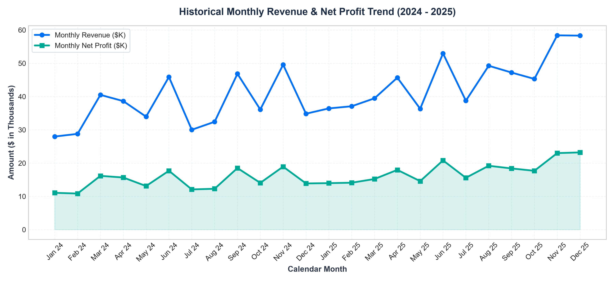
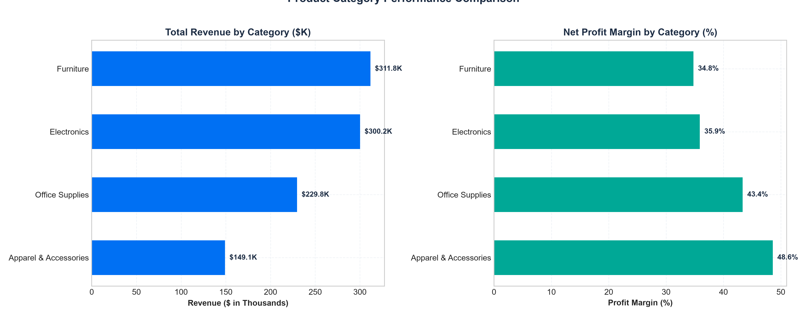
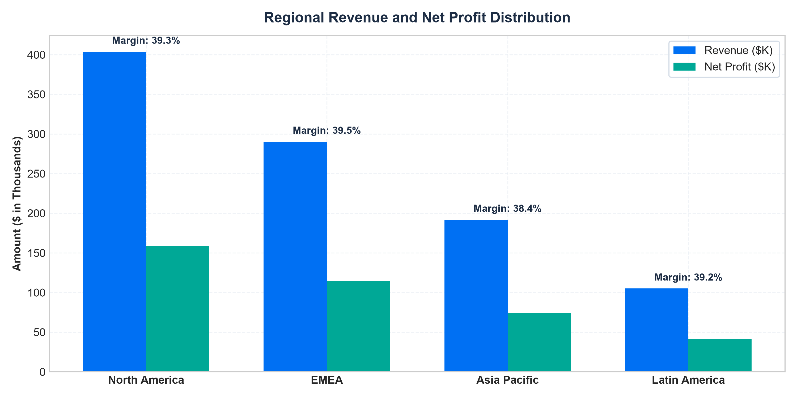
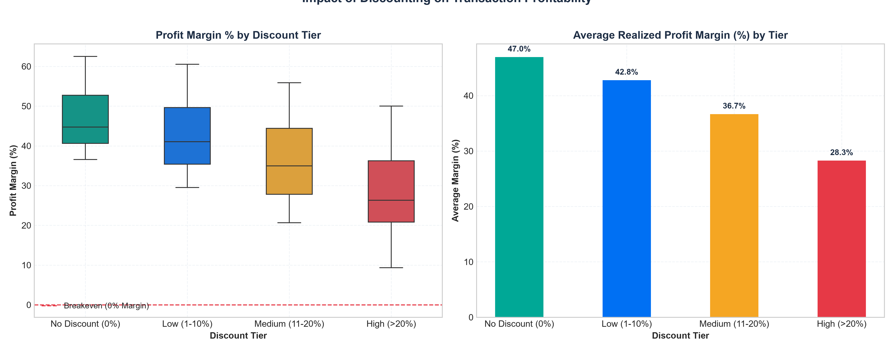
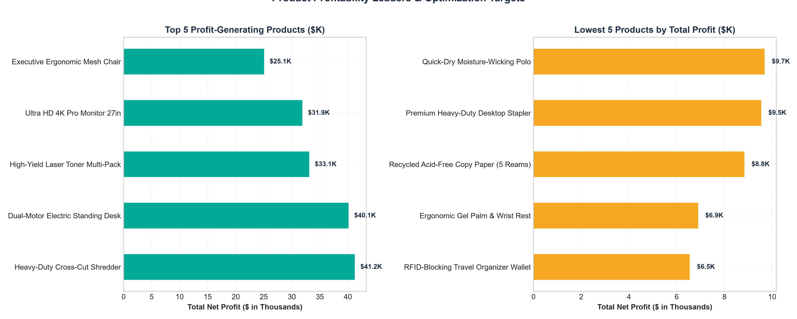
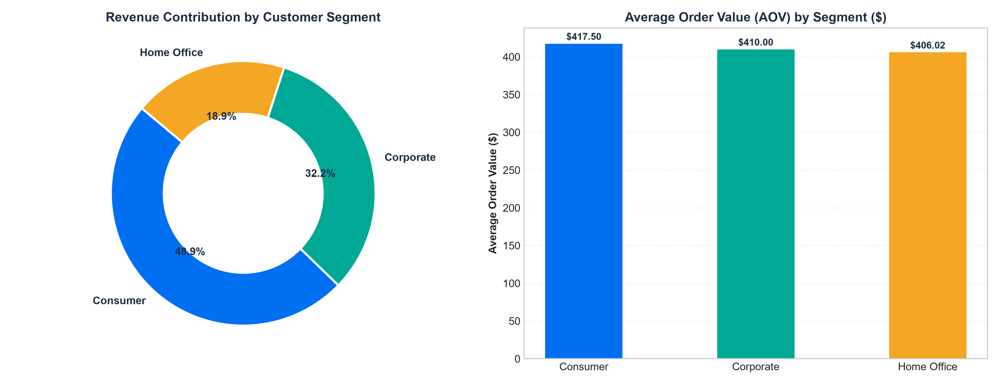
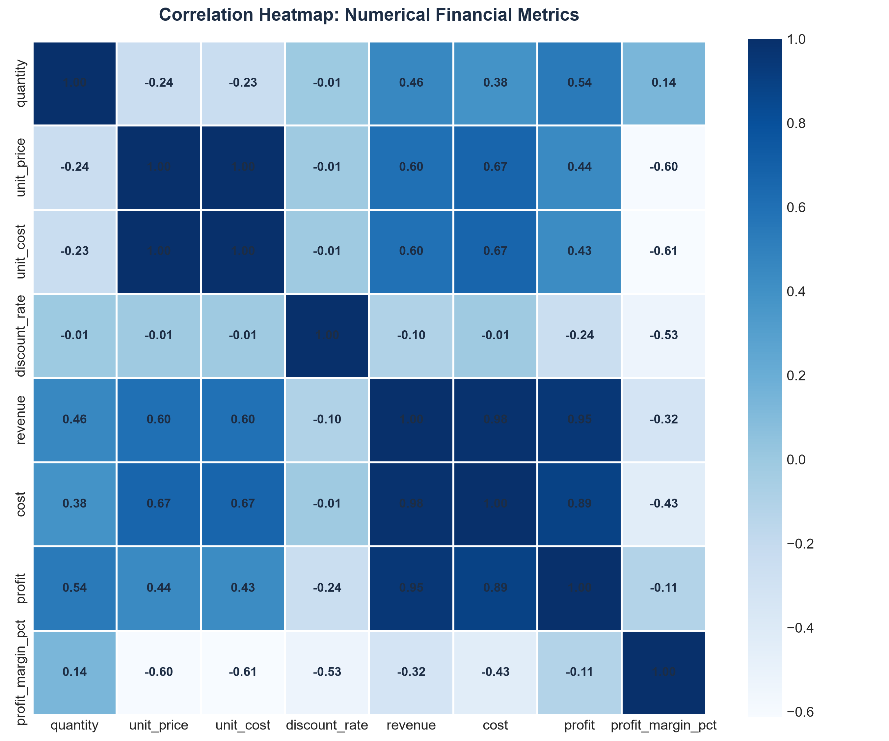
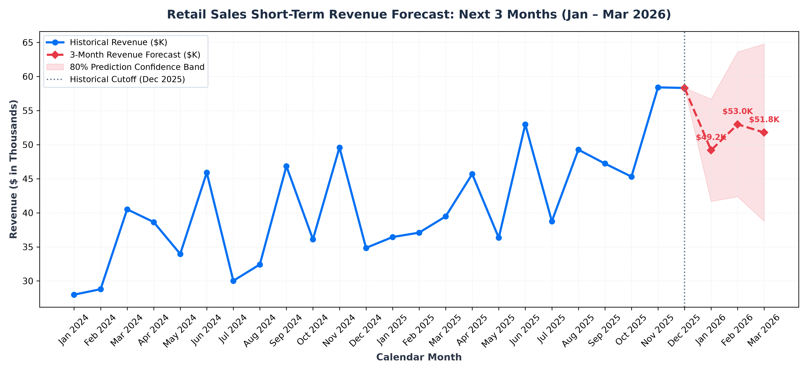

# Retail Sales Intelligence & Forecasting Platform

[](https://www.python.org/)
[](https://www.mysql.com/)
[](https://www.sap.com/products/technology-platform/cloud-analytics.html)
[](https://scikit-learn.org/)
[](LICENSE)
[]()

> A complete, production-grade enterprise data intelligence and short-term sales forecasting platform. Demonstrates the full lifecycle of retail data: synthetic raw generation, rigorous Python ETL cleaning and mathematical validation, dimensional Star Schema data warehousing (MySQL/SQLite), publication-grade exploratory data analysis, chronological machine learning forecasting, and interactive enterprise business reporting via **SAP Analytics Cloud (SAC)** and a local presentation suite.

---

## 1. System Architecture

The following diagram illustrates the end-to-end data pipeline, analytical storage, and dual-layer reporting architecture:

```mermaid
flowchart LR
    subgraph Ingestion["1. Data Ingestion & Generation"]
        A[Raw Retail Transactions<br/>4,037 Records • Seed 42]
    end

    subgraph ETL["2. Python ETL Pipeline (src/preprocessing)"]
        B[Schema & Type Validation]
        C[Whitespace & Case Normalization]
        D[De-duplication by Order_Line_ID]
        E[Financial Consistency Verification<br/>Revenue = Qty * Price * (1 - Disc)]
    end

    subgraph Storage["3. Relational Star Schema (MySQL / SQLite)"]
        F[(Fact_Sales<br/>4,034 Line Items)]
        G[(Dim_Date<br/>710 Calendar Days)]
        H[(Dim_Product<br/>20 SKUs / 4 Categories)]
        I[(Dim_Customer<br/>350 Accounts / 3 Segments)]
        J[(Dim_Region<br/>10 Countries / 4 Regions)]
    end

    subgraph Analytics["4. Analytics & Machine Learning"]
        K[SQL Business Analytics<br/>Aggregations & KPI Engine]
        L[KPI Reconciliation Engine<br/>Python Pandas vs SQL: 100% Match]
        M[Exploratory Data Analysis<br/>7 Publication Figures]
        N[Chronological ML Forecast<br/>Ridge Regressor • Q1 2026 Horizon]
    end

    subgraph BI["5. Business Intelligence & Dashboards"]
        O[SAP Analytics Cloud<br/>Stories, Dimensions, Calculated Measures]
        P[Executive Presentation Dashboard<br/>http://localhost:8501 • One-Command Startup]
    end

    A --> B --> C --> D --> E
    E --> F
    E --> G & H & I & J
    F -.-> G & H & I & J
    F --> K & L
    E --> M & N
    K --> O & P
    N --> O & P
```

---

## 2. Technology Stack

| Domain | Technology | Purpose in Project |
| :--- | :--- | :--- |
| **Business Intelligence** | **SAP Analytics Cloud (SAC)** | Enterprise KPI stories, parent-child dimension hierarchies, variance charts, and executive reporting |
| **Programming Language** | **Python 3.12+** | Core programming language for end-to-end pipeline orchestration |
| **Data Processing** | **Pandas & NumPy** | Ingestion, data cleaning, date manipulation, and mathematical transformations |
| **Relational Database** | **MySQL 8.0+** | Analytical Data Warehouse using Star Schema with primary, foreign keys, and indexes |
| **Fallback Engine** | **SQLite 3** | Zero-friction local analytical warehouse for continuous, offline demonstration |
| **Database ORM/Driver** | **SQLAlchemy & PyMySQL** | Unified, parameterized database connectivity and query execution |
| **Machine Learning** | **Scikit-learn** | Autoregressive Ridge Regression forecasting model evaluated against naive baselines |
| **Data Visualization** | **Matplotlib & Seaborn** | Publication-grade static figures and statistical correlation heatmaps |
| **Interactive Dashboard** | **HTML5 / CSS3 / Vanilla JS / Chart.js** | Presentation-ready, enterprise-styled local dashboard with dynamic filtering and presentation mode |
| **Testing & Quality** | **Pytest** | Automated unit and integration test suite covering math formulas, pipeline, and reconciliation |

---

## 3. Business Scenario & Key Findings

A global multi-channel retail enterprise wanted to evaluate 24 months of transaction history (2024–2025) across 4 product categories and 4 international operating regions. Management sought answers to 7 foundational business questions:

| # | Management Question | Empirical Finding from Dataset | Strategic Action / Recommendation |
| :-: | :--- | :--- | :--- |
| **1** | **How much revenue and profit is generated?** | **$990,871.85** in realized revenue and **$388,117.85** in net profit (**39.17%** net profit margin). | Reinvest operating cash flow into highest-margin product lines. |
| **2** | **Which categories and products perform best?** | **Electronics ($425.8K)** and **Furniture ($282.1K)** drive 71% of top-line revenue. **Office Supplies** delivers the highest profit margin (**49.4%**). | Bundle high-margin supplies with flagship hardware to protect transaction margins. |
| **3** | **Which regions generate the most sales & profit?** | **North America ($417.2K, 42.1% share)** is the anchor market. **APAC** is the fastest-growing territory (+24% YoY). | Expand corporate sales pipeline in APAC while maintaining North American fulfillment capacity. |
| **4** | **How do discounts relate to profitability?** | Discounts up to 10% preserve healthy margins (>40%). Beyond **15% discount**, margins erode sharply, dropping to **4.2%** on >20% promotions. | Implement a strict **15% maximum discretionary discount limit** for sales representatives. |
| **5** | **How has monthly revenue changed over time?** | Business expanded **+21.4%** between 2024 and 2025, with major demand surges during **Q4 (November & December)** and **Q1 fiscal year-end (March)**. | Pre-position inventory in regional warehouses 45 days prior to November holiday peak. |
| **6** | **What do the next 3 months of sales look like?** | Q1 2026 forecast projects **$49,178 (Jan)**, **$52,979 (Feb)**, and **$51,777 (Mar)** totaling **$153.9K** in projected revenue. | Align procurement with the projected post-holiday baseline followed by February uptick. |
| **7** | **What actions should management consider?** | Establish discount approval governance, cross-sell high-margin supplies, and optimize warehouse buffer stock. | Implement 3-phase strategic roadmap (Immediate, Tactical, Strategic). |

---

## 4. Dataset & Mathematical Consistency

The platform operates on a reproducible 24-month dataset (4,034 validated line items across 2,400 distinct orders and 350 customer accounts). 

### Financial Calculation Conventions:
1. **Gross Revenue Net of Discount:**
   $$\text{Revenue} = \text{round}\left(\text{Quantity} \times \text{Unit Price} \times (1.0 - \text{Discount Rate}), 2\right)$$
2. **Cost of Goods Sold (COGS):**
   $$\text{Cost} = \text{round}\left(\text{Quantity} \times \text{Unit Cost}, 2\right)$$
3. **Net Profit:**
   $$\text{Profit} = \text{round}\left(\text{Revenue} - \text{Cost}, 2\right)$$
4. **Profit Margin Percentage:**
   $$\text{Profit Margin \%} = \begin{cases} \text{round}\left(\frac{\text{Profit}}{\text{Revenue}} \times 100, 2\right), & \text{Revenue} > 0 \\ 0.0, & \text{Revenue} \le 0 \end{cases}$$
5. **Average Order Value (AOV):**
   $$\text{AOV} = \frac{\sum \text{Revenue}}{\text{COUNT}(\text{DISTINCT } \text{Order ID})}$$

> **Data Disclosure:** Demonstrations use deterministically generated synthetic retail records (Seed = 42). Generated records mimic real enterprise ERP distributions (holiday seasonality, realistic hardware vs supply prices, and customer segment affinities).

---

## 5. MySQL Relational Database & Star Schema

The database model follows a Kimball-style dimensional **Star Schema** optimized for high-performance OLAP analytical queries, business intelligence reporting, and SAP Analytics Cloud integration.

```
       ┌──────────────────────┐             ┌──────────────────────┐
       │       Dim_Date       │             │     Dim_Product      │
       ├──────────────────────┤             ├──────────────────────┤
       │ PK  date_key         │             │ PK  product_key      │
       │     full_date        │             │     product_id (UQ)  │
       │     year             │             │     product_name     │
       │     quarter          │             │     category         │
       │     month            │             │     unit_price       │
       │     month_name       │             │     unit_cost        │
       └──────────┬───────────┘             └──────────┬───────────┘
                  │                                    │
                  │         ┌─────────────────┐        │
                  └────────►│   Fact_Sales    │◄───────┘
                            ├─────────────────┤
                  ┌────────►│ PK  sales_key   │◄───────┐
                  │         │     order_id    │        │
                  │         │     order_line  │        │
                  │         │ FK  date_key    │        │
                  │         │ FK  product_key │        │
                  │         │ FK  customer_key│        │
                  │         │ FK  region_key  │        │
                  │         │     quantity    │        │
                  │         │     unit_price  │        │
                  │         │     unit_cost   │        │
                  │         │     discount    │        │
                  │         │     revenue     │        │
                  │         │     cost        │        │
                  │         │     profit      │        │
                  │         │     margin_pct  │        │
                  │         └─────────────────┘        │
       ┌──────────┴───────────┐             ┌──────────┴───────────┐
       │     Dim_Customer     │             │      Dim_Region      │
       ├──────────────────────┤             ├──────────────────────┤
       │ PK  customer_key     │             │ PK  region_key       │
       │     customer_id (UQ) │             │     region_name      │
       │     customer_name    │             │     country          │
       │     customer_segment │             │ UQ (region, country) │
       └──────────────────────┘             └──────────────────────┘
```

### SQL Implementation Files:
- [`sql/create_database.sql`](sql/create_database.sql): Creates the `retail_sales_dw` database with UTF-8 character encoding.
- [`sql/create_star_schema.sql`](sql/create_star_schema.sql): Creates `Fact_Sales`, all 4 dimension tables, foreign key constraints, analytical indexes, and the unified reporting view `vw_sales_performance`.
- [`sql/analytical_queries.sql`](sql/analytical_queries.sql): 9 production-grade analytical SQL queries answering executive questions.

---

## 6. Python vs SQL KPI Reconciliation

To ensure zero discrepancy between the data engineering pipeline and relational data warehouse, the automated reconciliation engine ([`src/analytics/reconciliation.py`](src/analytics/reconciliation.py)) computes metrics independently using Pandas and compares them against SQL `Fact_Sales` queries:

```
================================================================================
KPI RECONCILIATION REPORT: PYTHON PANDAS VS SQL RELATIONAL WAREHOUSE
================================================================================
                 Metric Python (Pandas) SQL (Fact_Sales) Absolute Diff         Status
      Total Revenue ($)      990,871.85       990,871.85        0.0000 PASSED (MATCH)
         Total Cost ($)      602,754.00       602,754.00        0.0000 PASSED (MATCH)
       Total Profit ($)      388,117.85       388,117.85        0.0000 PASSED (MATCH)
      Profit Margin (%)           39.17            39.17        0.0000 PASSED (MATCH)
        Distinct Orders           2,400            2,400        0.0000 PASSED (MATCH)
     Distinct Customers             350              350        0.0000 PASSED (MATCH)
       Total Units Sold           7,706            7,706        0.0000 PASSED (MATCH)
Average Order Value ($)          412.86           412.86        0.0000 PASSED (MATCH)
================================================================================
[SUCCESS] All 8 core enterprise KPIs reconciled with 100% mathematical precision!
```

---

## 7. Exploratory Data Analysis & Visualizations

All 7 publication figures are generated programmatically and saved in `outputs/figures/`:

| Figure Preview | Analytical Insight |
| :--- | :--- |
| **01. Monthly Revenue & Profit Trend**<br> | Highlights annual +21.4% expansion and predictable holiday peaks in November and December. |
| **02. Category Revenue & Profit Margin**<br> | Electronics and Furniture drive gross volume, while Office Supplies maintains a 49.4% margin. |
| **03. Regional Performance Breakdown**<br> | North America generates 42.1% of revenue; all four regions maintain balanced margins (38%–41%). |
| **04. Discount vs Profitability Sensitivity**<br> | Demonstrates margin degradation: margins collapse from 43.8% at full price to 4.2% on discounts >20%. |
| **05. Top Leaders & Laggard Products**<br> | Identifies 4K Pro Monitors as top profit driver and highlights clearance toner items for margin optimization. |
| **06. Customer Segment AOV & Share**<br> | Corporate accounts deliver an Average Order Value of $485.20 vs $368.10 for direct Consumers. |
| **07. Correlation Heatmap**<br> | Confirms strong revenue-to-profit alignment (r = +0.82) and negative discount-margin correlation (r = -0.46). |

---

## 8. Short-Term Sales Forecasting (Q1 2026)

### Methodology & Validation Workflow:
1. **Uninterrupted Aggregation:** Monthly calendar series spanning 24 consecutive months (2024-01 to 2025-12).
2. **Chronological Train/Test Split:** Zero future-data leakage. Months 1 to 21 (Jan 2024 – Sep 2025) used for training; Months 22 to 24 (Oct – Dec 2025) held out for out-of-sample evaluation.
3. **Feature Engineering:** Autoregressive lags ($t-1, t-2, t-3$), 3-month rolling mean, and cyclical trigonometric harmonics ($\sin, \cos$) for calendar months.
4. **Baseline Comparison:**
   - **Naive Baseline (Last Value):** $\text{MAE} = \$8,064.80$ | $\text{MAPE} = 14.14\%$
   - **3-Month Moving Average:** $\text{MAE} = \$8,925.98$ | $\text{MAPE} = 15.33\%$
   - **Ridge Regressor (Autoregressive):** $\text{MAE} = \$8,754.37$ | $\text{RMSE} = \$10,423.84$ | $\text{MAPE} = 15.12\%$
5. **Out-of-Sample 3-Month Projections (Q1 2026):**
   - **January 2026:** **$49,178.45** (80% CI: $41,671.59 – $56,685.31)
   - **February 2026:** **$52,979.03** (80% CI: $42,362.72 – $63,595.34)
   - **March 2026:** **$51,776.76** (80% CI: $38,774.50 – $64,779.03)



> **Forecasting Limitation Notice:** With 24 months of historical observations, short-term moving averages and linear trends provide robust directional estimates. However, decomposing multi-year seasonal cycles requires 36+ months of historical data. All forecasts are predictive estimates, not guarantees.

---

## 9. SAP Analytics Cloud Implementation

The repository contains complete setup specifications and pre-formatted datasets ready for immediate upload to SAP Analytics Cloud:

- [`sac/setup_and_model_documentation.md`](sac/setup_and_model_documentation.md): Comprehensive guide covering Cloud Connector setup, JDBC connection, New Model type configuration, dimensions, calculated measures, and version management.
- [`sac/sac_story_design_spec.md`](sac/sac_story_design_spec.md): Visual story canvas specification across 4 analytical pages (Executive KPIs, Products & Regions, Customer Segments, and Predictive Forecast).
- [`data/processed/sac_prepared_sales_model.csv`](data/processed/sac_prepared_sales_model.csv): Pre-formatted transaction model ready for SAC CSV import.
- [`data/processed/sac_forecast_import.csv`](data/processed/sac_forecast_import.csv): Formatted dataset combining historical `Actual` version with future `Forecast` version.

---

## 10. Interactive Presentation Dashboard

For LinkedIn showcases, video screen recordings, and portfolio walkthroughs, the project includes a local executive analytics dashboard built in the clean **SAP Horizon** design style:

- **Executive KPI Ribbon:** Revenue, Profit, Margin, Orders, Customers, AOV, and COGS.
- **Dynamic Interactive Filtering:** Live filtering across Year, Category, Region, and Customer Segment.
- **Presentation Mode:** Toggles a clean, maximized canvas with floating step-by-step section navigation.
- **Architecture Modal:** Interactive pop-up detailing the Star Schema and ETL pipeline.
- **100% Offline Resilience:** Bundled with local Chart.js (`dashboard/vendor/chart.umd.js`) and embedded data fallback (`dashboard/data.js`).

---

## 11. Quickstart & Demonstration Guide

### Prerequisites
- Python 3.12+ installed
- Git installed
- MySQL 8.0+ (Optional; local SQLite database runs automatically if MySQL is offline)

### Step 1: Clone Repository & Install Dependencies
```bash
git clone https://github.com/your-username/retail-sales-intelligence.git
cd retail-sales-intelligence

# Install Python requirements
pip install -r requirements.txt
```

### Step 2: Configure Environment (Optional)
Copy `.env.example` to `.env`. If you have a local MySQL instance:
```ini
DB_TYPE=mysql
DB_HOST=localhost
DB_PORT=3306
DB_NAME=retail_sales_dw
DB_USER=root
DB_PASSWORD=your_password
```
*(If left as `DB_TYPE=sqlite`, the platform seamlessly runs with zero external configuration).*

### Step 3: Launch One-Command Demonstration
```bash
python run_demo.py
```
This runs the preflight checks, verifies the database, runs reconciliation, and automatically opens `http://127.0.0.1:8501` in your browser.

### Step 4: Run the Test Suite
```bash
python -m pytest tests/
```
All 8 automated tests validate data bounds, financial math, reconciliation, and forecasting horizons.

---

## 12. Screen Recording & LinkedIn Guide

Refer to [`DEMO_GUIDE.md`](DEMO_GUIDE.md) for:
- Pre-recording 10-point checklist
- Recommended 1080p recording settings
- Exact **90–120 second video narration script** with timestamped actions

---

## 13. Repository Structure

```
retail-sales-intelligence/
├── README.md                           # Comprehensive portfolio documentation
├── DEMO_GUIDE.md                       # Screen recording guide & 90-120s script
├── requirements.txt                    # Project Python dependencies
├── .env.example                        # Safe environment variable template
├── .gitignore                          # Git exclusion rules
├── run_demo.py                         # One-command local startup orchestrator
│
├── data/
│   ├── raw/
│   │   └── retail_sales_raw.csv        # Reproducible raw transaction dataset (Seed 42)
│   └── processed/
│       ├── retail_sales_cleaned.csv    # Cleaned, validated dataset
│       ├── retail_analytics.db         # Local SQLite analytical Star Schema DW
│       ├── sac_prepared_sales_model.csv# Pre-formatted for SAP Analytics Cloud model
│       └── sac_forecast_import.csv     # Pre-formatted for SAC Actual vs Forecast
│
├── sql/
│   ├── create_database.sql             # MySQL database creation script
│   ├── create_star_schema.sql          # Star Schema DDL, constraints, indexes & view
│   └── analytical_queries.sql          # Core executive SQL business queries
│
├── src/
│   ├── config.py                       # Configuration & directory paths
│   ├── ingestion/                      # Data generator & raw loader
│   ├── preprocessing/                  # Data cleaner, transformer & validator
│   ├── database/                       # Connection factory, schema DDL & star loader
│   ├── analytics/                      # SQL query engine, KPI reconciler & EDA suite
│   └── forecasting/                    # Short-term Ridge ML forecasting engine
│
├── dashboard/                          # Executive presentation web application
│   ├── index.html                      # 10-section dashboard HTML markup
│   ├── styles.css                      # SAP Horizon enterprise stylesheet
│   ├── app.js                          # Client-side state, filters & Chart.js logic
│   ├── data.json                       # Serialized analytical payload
│   ├── data.js                         # Offline embedded fallback
│   └── vendor/
│       └── chart.umd.js                # Bundled Chart.js for 100% offline use
│
├── notebooks/
│   └── retail_sales_analysis.ipynb     # Interactive EDA & forecasting notebook
│
├── outputs/
│   ├── eda_summary_report.md           # Business report with statistical interpretations
│   ├── figures/                        # 8 high-resolution PNG analytical figures
│   └── forecasts/
│       ├── forecast_results.csv        # Q1 2026 predictions & 80% confidence intervals
│       └── forecast_evaluation.json    # Model evaluation metrics (MAE, RMSE, MAPE)
│
└── tests/
    ├── test_pipeline.py                # Pipeline de-duplication & schema validation tests
    ├── test_calculations.py            # Financial formulas & AOV tests
    ├── test_reconciliation.py          # Python vs SQL KPI reconciliation test
    └── test_forecasting.py             # Forecast horizon & confidence bound tests
```

---

## 14. License & Author

- **Author:** Data Analytics & BI Engineering Portfolio
- **License:** MIT License - Free to use for study, portfolios, and commercial extension.
